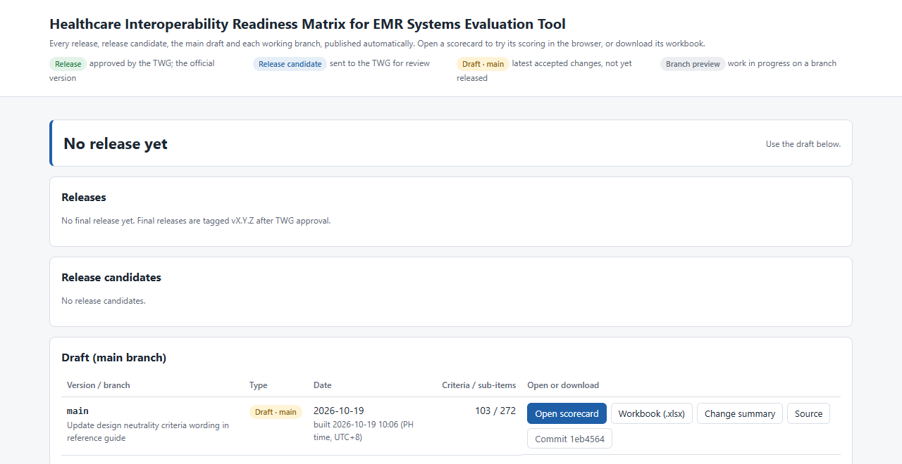
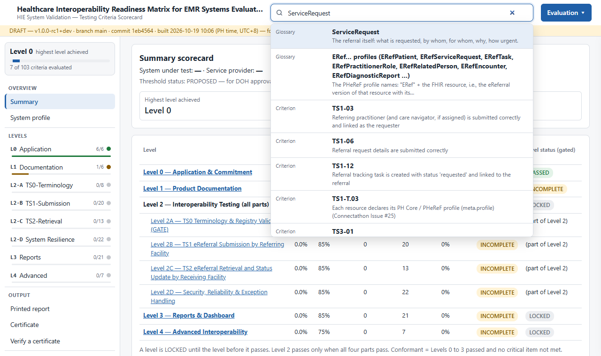
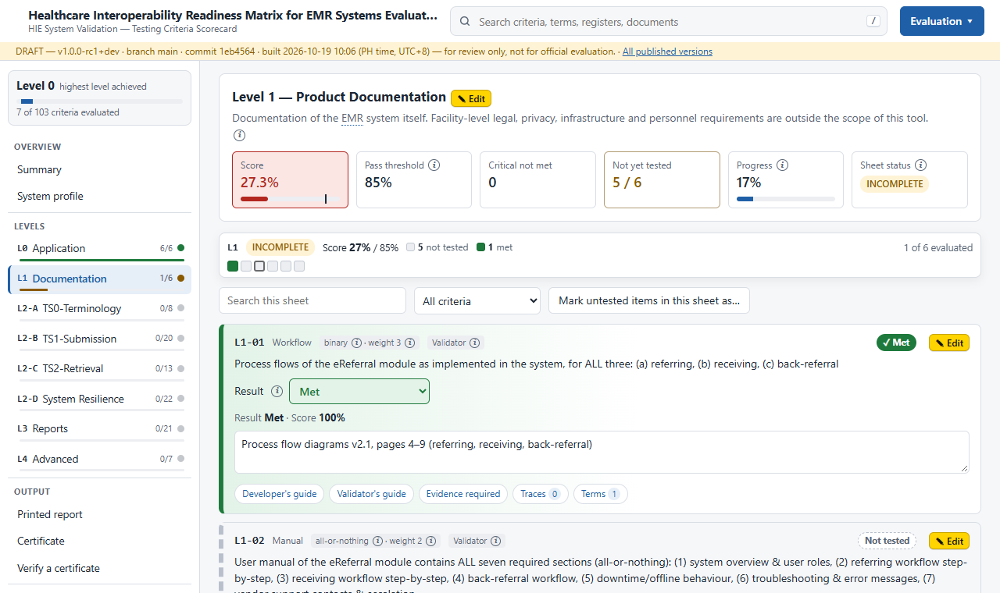
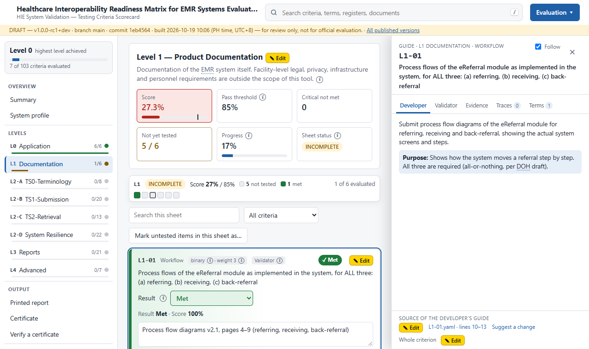
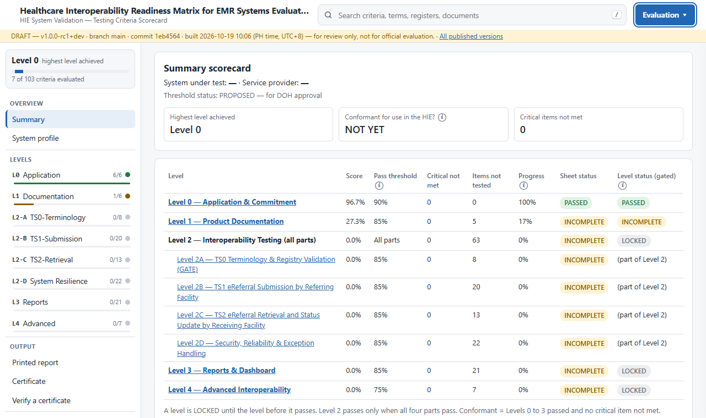
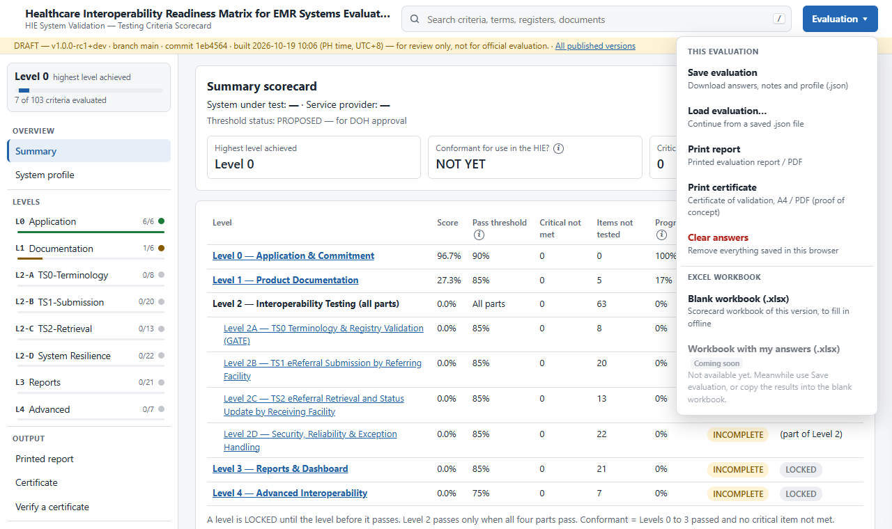
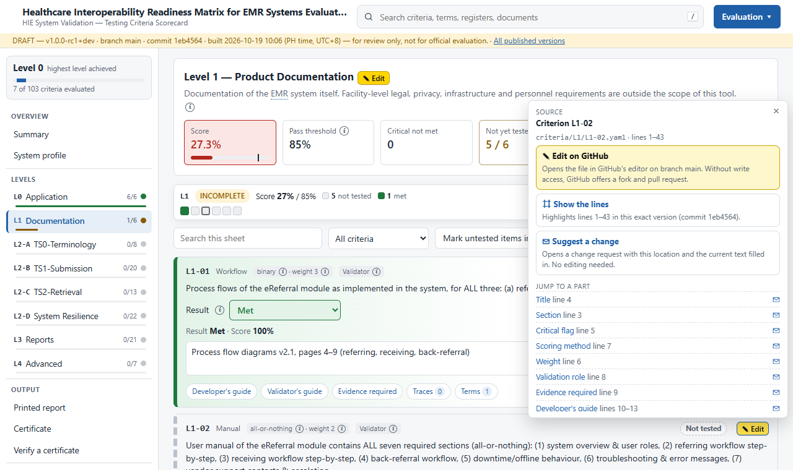
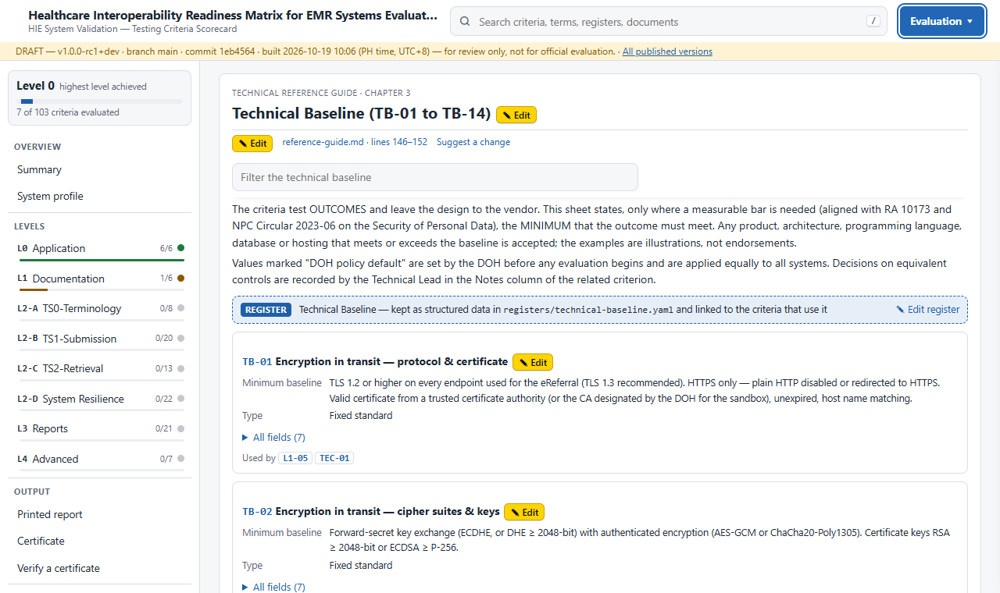
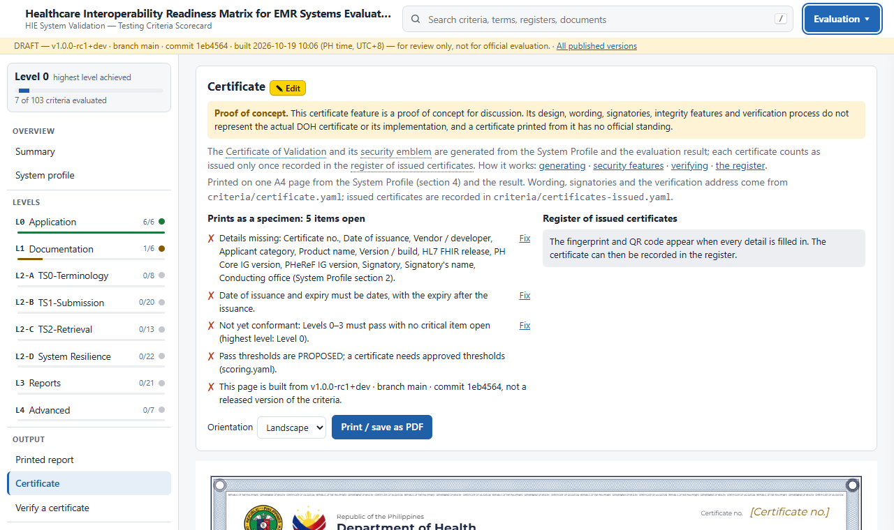

# Healthcare Interoperability Readiness Matrix for EMR Systems Evaluation Tool

Level-based testing criteria used to check whether an EMR system conforms to an interoperability standard and for use in the Health Information Exchange (HIE).

**Changelog:** Check the [recent changes to the testing criteria since Oct. 1, 2026, as of October 19, 2026](#changelog)

**Open the scorecard: <https://dohwvchdictu.github.io/hirmes-tool/>**

Everything a reviewer needs is on that site: test a system against the criteria, read the guides and
the Technical Reference Guide, print the report, and propose a change to any line. Testing needs no
installation and no GitHub account. Proposing a change needs a free GitHub account.

| You want to… | Go to |
| --- | --- |
| Test a system against the criteria | [The scorecard site](https://dohwvchdictu.github.io/hirmes-tool/), see [Using the scorecard site](#using-the-scorecard-site) |
| Review the criteria and propose a change | ✉ **Suggest a change** on any item in the site, or [open an issue](../../issues/new/choose) |
| Download the official files | [Releases](../../releases): scorecard workbook, change summary, change log, web scorecard (`.zip`) |
| See what changed and why | `CHANGE-SUMMARY.md` in each release, or the [commit history](../../commits) |
| Edit the criteria files | [CONTRIBUTING.md](CONTRIBUTING.md) |
| Set up the GitHub repository | [docs/maintainer-setup.md](docs/maintainer-setup.md) |

## Using the scorecard site

### 1. Pick a version

The landing page lists every version of the criteria. Choose **Open scorecard** on the row you need.



| Label | What it is | Use it to |
| --- | --- | --- |
| Release | Approved by the Project Workstreams; the official version | Practise and prepare for an evaluation (the released workbook is the official, signed record) |
| Release candidate | Sent to the Project Workstreams for review | Review what the Project Workstreams are asked to approve |
| Draft · main | Latest accepted changes, not yet released | See the current state of the criteria |
| Branch preview | A proposed change in progress | Check a change before it is accepted |

Each row also links to that version's workbook (`.xlsx`), change summary and source. The yellow bar
at the top of every scorecard page names the version, branch and commit you are looking at, and
*All published versions* returns to the landing page.

### 2. Find your way around



- **Sidebar.** *Overview* (Summary, System profile), *Levels* (one sheet per level, with its progress),
  *Output* (Printed report, Certificate, Verify a certificate) and *Reference* (the Technical Reference
  Guide, glossary and registers).
- **Search.** Press `/` or click the search box to find any criterion, term, register entry or
  document section.
- **Terms.** Underlined terms and dotted abbreviations in the criteria open a short definition.
- **ⓘ** next to a control explains it: result options, scoring types, weights, thresholds.
- **Links.** Every page and criterion has its own address (for example `#L1/L1-01`), so you can send a
  link to the exact item you mean.

### 3. Test a system

Open a level in the sidebar and set the **Result** of each criterion (Met, Not Met, Not Tested or
N/A; some criteria are answered per sub-item). Write the evidence you checked in the notes box.
Scores, sheet status and the level achieved update as you answer.



The buttons under each criterion open the **guide drawer**: what the developer must provide, how the
validator checks it, the evidence required, its traces to the FHIR profiles and registers, and its
terms. Tick *Follow* to keep the drawer in step with the criterion you click.



Fill in the **System profile** (application, product, versions, testing team), then open the
**Summary** to see every level at once. A level stays LOCKED until the level before it passes; a
system is conformant when Levels 0 to 3 pass with no critical item not met.



### 4. Save, print and download

Your answers, notes and profile are kept **in this browser only** and saved as you type; nothing is
sent to a server. Use the **Evaluation** menu to keep or share them:



| Menu item | What it does |
| --- | --- |
| Save evaluation | Downloads answers, notes and profile as a `.json` file. Save often, and before clearing the browser or changing computers |
| Load evaluation… | Continues from a saved `.json` file, on any computer |
| Print report | The printed evaluation report, or a PDF through the browser's print dialog |
| Print certificate | The Certificate of Validation (proof of concept, see [step 6](#6-certificate-proof-of-concept)) |
| Clear answers | Removes everything saved in this browser |
| Blank workbook (.xlsx) | The scorecard workbook of this version, to fill in offline |

A workbook filled with the web answers is not available yet. Use *Save evaluation*, or copy the
results into the blank workbook.

### 5. Review the criteria and propose a change

Every criterion, sheet heading, guide, help text, glossary term, register entry and Reference
section has a yellow **✎ Edit** button. It shows the file and lines the item comes from and offers
three actions:



| Action | What it does | Who it suits |
| --- | --- | --- |
| ✉ Suggest a change | Opens a change request (a GitHub issue) with the item, its location and its current text filled in. Add what it should say and why | Project Workstream members and reviewers (no editing needed) |
| ⌗ Show the lines | Opens the source file at those lines, in the exact version the page was built from | Anyone checking where a text comes from |
| ✎ Edit on GitHub | Opens the file in GitHub's editor. Without write access GitHub makes a copy (fork) and a pull request for you | Editors |

*Jump to a part* lists each field of a criterion (title, weight, critical flag, guides, sub-items)
with its own ✉, so a suggestion can point at one field. You can also
[open a change request](../../issues/new/choose) directly and choose the kind of change: wording,
correction, new criterion, retire or move, or a policy change (weight, critical flag, threshold).

The **Reference** section holds the Technical Reference Guide, with the glossary and the registers
(Technical Baseline, sources, FHIR traceability, indicators) inserted where they belong. Each
register entry lists the criteria that use it, and every section and entry has its own ✎.



**What happens next.** A maintainer answers the issue. An accepted change is made on a branch, which
gets its own *Branch preview* on the landing page so you can check it. Once merged it appears in
*Draft · main*, and it is listed in the change summary of the next release candidate sent to the Project Workstreams.

### 6. Certificate (proof of concept)

*Output › Certificate* prints a Certificate of Validation from the System Profile and the results.
The page lists what is still missing; until everything is in order it prints as a SPECIMEN. Its QR
code opens *Verify a certificate*, which checks the number and fingerprint against the register of
issued certificates. This feature is a proof of concept for discussion and is not an official DOH
certificate; see [CONTRIBUTING.md](CONTRIBUTING.md#certificates).



## About this repository

The criteria are kept as plain text. Every output is generated from them, so a change is made once
and every file stays in sync. The rest of this README is for maintainers and editors.

### What is in this repository

```
criteria/            one YAML file per criterion, in a folder per sheet (L0, L1, L2A–L2D, L3, L4)
criteria/sheets.yaml sheet titles, introductions and the display order of criteria
criteria/profile.yaml              sections, fields and choices of the System Profile form
criteria/certificate.yaml          wording, signatories and logos of the Certificate of Validation (proof of concept)
criteria/certificates-issued.yaml  register of issued certificates (what the QR code verifies against)
criteria/retired-legacy.yaml  IDs retired before this repository existed (kept reserved)
scoring.yaml         pass thresholds, level gating and the Project Workstreams approval record
registers/           Technical Baseline (TB-), sources (SRC-), FHIR traceability (TR-), indicators (IND-),
                     glossary, abbreviations, ID prefixes, and form-help.yaml (the ⓘ help in the web scorecard)
schema/              rules every YAML file must follow
templates/           workbook layout used to generate the scorecard
scripts/             check, build, publish and change-summary scripts (import_rev9.py: the one-time Rev 9 import)
tool/                web scorecard (static page), certificate code (cert.js), letterhead images (img/)
                     and landing page template
tests/               round-trip, scoring and certificate tests
docs/                Technical Reference Guide (prose; its tables come from registers/, see docs/README.md)
                     and the one-time GitHub setup (maintainer-setup.md)
.github/             workflows (check, publish, release) and issue templates (change request, certificate record)
```

### How outputs are produced

| Output | Built by | When |
| --- | --- | --- |
| Scorecard workbook (`.xlsx`) | `scripts/build_xlsx.py` | Every push (download from the workflow run or the web scorecard's Evaluation menu) and every release |
| Web scorecard and landing page | `scripts/build_web.py` (with `scripts/build_reference.py` for the glossary, registers and documents), `scripts/publish.py` | Every push to any branch or tag (GitHub Pages, `gh-pages` branch); a `.zip` of the scorecard with every release |
| Printed report and certificate (PDF) | The web scorecard: Output › Printed report and Output › Certificate in the sidebar, or the Evaluation menu (the certificate is a proof of concept, see [CONTRIBUTING.md](CONTRIBUTING.md#certificates)) | On demand, from an evaluation |
| Change summary | `scripts/change_summary.py` | Every release (compared with the previous release) |
| Change log | git-cliff, from commit messages | Every release |

The web scorecard also carries the glossary, registers and documents: terms in the criteria open a
short popover, each criterion has a guide drawer (Developer, Validator, Evidence, Traces, Terms), and
the Reference tab and search box (press `/`) lead to every register entry and document chapter. See
[CONTRIBUTING.md](CONTRIBUTING.md#help-terms-and-documents-in-the-web-scorecard) for how to edit them.

Every file carries its version, branch and commit, so a printed copy can be traced to its source.

### Proposed Versioning

- The first release from this repository is **Revision 1** (`v1.0.0`). Legacy revisions (Rev 3–9) were
  produced outside the repository; the Rev 9 content was imported as the starting content.
- Drafts sent to the Project Workstreams for review are release candidates: `v1.0.0-rc1`, `v1.0.0-rc2`, …
- Later revisions step the major version (`v2.0.0`); text clarifications without scoring effect step
  the minor version (`v1.1.0`); fixes to a released version step the patch (`v1.0.1`).
- The released workbook is the official, signed record. The web scorecard is a review and practice tool.

### Run it locally

```bash
python -m pip install -r requirements.txt
python scripts/check.py --counts        # validate everything and print the Count Register
python scripts/build_xlsx.py            # writes dist/testing-criteria-scorecard-<version>.xlsx
python scripts/build_web.py             # writes site/
python -m http.server -d site 8000      # open http://localhost:8000
python tests/test_roundtrip.py          # workbook rows match the YAML
python tests/test_certificate.py        # certificate fingerprints and QR codes (needs Node.js; pip install qrcode for the full QR check)
python tests/test_scoring.py            # workbook and web give the same results (needs LibreOffice and Node.js)
python scripts/change_summary.py        # what changed in the criteria since the previous tag
```

## Changelog
The following indicates the changes made to the testing criteria from the draft revision presented at the Aklan Health Information Exchange Pre-Deployment Workshop for 2027 Roll-Out at DOH Central Office last October 1, 2026

### Criteria added

- **TS0**: Add TS0-05 international code systems (SNOMED CT, LOINC, ICD-10) valid on the DOH terminology server (Count 3, W2) *(affects scoring)*
- **TS0**: Add TS0-06 national registries PSGC ★, NHFR ★, NHWR (split out of rev2 TS0-01.1 to TS0-01.3; NHFR absorbs L4-09) (Count 3, critical via ★, W2) *(affects scoring)*
- **TS0**: Add TS0-07 patient identifiers PhilHealth ID ★ and PhilSys ★, format validated, malformed values rejected (moved from L4-07, Connectathon Issue #5) (Count 2, critical, W2) *(affects scoring)*
- **TS0**: Add TS0-08 optional DSWD household / beneficiary ID (SRC-15) (Binary, info-only, W0) *(affects scoring)*
- **TS0-01**: Add required bindings civil status (MaritalStatus) ★ and next-of-kin relationship ★ as TS0-01.3 and TS0-01.4 *(affects scoring)*
- **TS0-02**: Add TS0-02.3 Priority ★ (EReferralPriority: routine / urgent / stat); Task status moves to TS0-02.5 ★ *(affects scoring)*
- **L1-05**: Add L1-05.5 privacy-by-design / privacy-by-default: data minimisation, retention, secure disposal (TB-11; NPC Circular 2023-06) *(affects scoring)*
- **TS1**: Add TS1-01 referring facility details (Count 5, 1 ★ NHFR code, W2) *(affects scoring)*
- **TS1**: Add TS1-02 receiving facility details (Count 3, 1 ★ NHFR code, W2) *(affects scoring)*
- **TS1**: Add TS1-03 referring practitioner and care navigator, linked as requester (Count 4, 2 ★: role, and new TS1-03.4 requester link, W2) *(affects scoring)*
- **TS1**: Add TS1-04 patient demographics and identifiers (Count 9, 3 ★: PhilSys, PhilHealth, sex; adds TS1-04.9 PWD registration, W2) *(affects scoring)*
- **TS1**: Add TS1-05 accompanied by / next of kin, as Patient.contact or ERefRelatedPerson (TR-022) (Binary, W1) *(affects scoring)*
- **TS1**: Add TS1-06 referral request details (Count 6, 4 ★: referral category, new priority, reason for referral, new ServiceRequest links; adds TS1-06.6 fixed values intent / status, W2) *(affects scoring)*
- **TS1**: Add TS1-07 chief complaint, working impression ★ and clinical history (Count 3, W2) *(affects scoring)*
- **TS1**: Add TS1-08 vital signs with LOINC code, vital-signs category and UCUM unit (Count 6, 1 ★ blood pressure panel, W2) *(affects scoring)*
- **TS1**: Add TS1-09 laboratory result attachment (Binary, W1) *(affects scoring)*
- **TS1**: Add TS1-10 treatment given before referral (Binary, W1) *(affects scoring)*
- **TS1**: Add TS1-11 professional signature and its date / time (Count 2, W1) *(affects scoring)*
- **TS1**: Add TS1-12 referral tracking Task: status requested ★, focus to ServiceRequest ★, requester / owner, authoredOn (Count 4, W2) *(affects scoring)*
- **TS1**: Add TS1-13 referral linked to the referring encounter (Binary, W1) *(affects scoring)*
- **TS1**: Add TS1-14 time called, for information (Binary, W0) *(affects scoring)*
- **TS1**: Add TS1-15 mode of transportation, for information (Binary, W0) *(affects scoring)*
- **TS1**: Add TS1-16 patient matching: three referrals reuse one existing Patient (moved from L4-08) (Count 3, all ★, critical, W2) *(affects scoring)*
- **TS1-T.03**: Add RelatedPerson (N/A if Patient.contact is used) to the meta.profile check, 12 to 13 resources; Procedure becomes MedicationAdministration or Procedure *(affects scoring)*
- **TS2**: Add TS2-01 receiving facility finds new referrals without typing an ID (re-keys TS2-T.01) (Binary, critical, W2) *(affects scoring)*
- **TS2**: Add TS2-02 referring and receiving facility details (Count 7, 2 ★, W2) *(affects scoring)*
- **TS2**: Add TS2-03 referring practitioner and care navigator (Count 3, 1 ★, W2) *(affects scoring)*
- **TS2**: Add TS2-04 patient demographics and identifiers (Count 11, 3 ★, W2) *(affects scoring)*
- **TS2**: Add TS2-05 referral request details (Count 4, 3 ★, W2) *(affects scoring)*
- **TS2**: Add TS2-06 clinical findings (Count 4, 1 ★, W2) *(affects scoring)*
- **TS2**: Add TS2-07 vital signs, value and unit (Count 6, 1 ★, W2) *(affects scoring)*
- **TS2**: Add TS2-08 laboratory attachment received and listed with the referral (Binary, W1) *(affects scoring)*
- **TS2**: Add TS2-09 treatment given and professional signature (Count 3, W1) *(affects scoring)*
- **TS2**: Add TS2-10 receiving practitioner / care navigator kept separate from the referring practitioner (Count 4, 2 ★ including new TS2-10.4, W2) *(affects scoring)*
- **TS2**: Add TS2-11 receiving response updates the Task: received ★, accepted ★ (new), rejected with reason, completed (new) (Count 4, W2) *(affects scoring)*
- **TS2**: Add TS2-12 status changes shown at the referring facility (re-keys TS2-T.02) (Binary, critical, W2) *(affects scoring)*
- **TS2**: Add TS2-13 every status change time-stamped and kept: requested ★, received ★, accepted / rejected ★, completed ★ (moved from L4-06) (Count 4, critical, W2) *(affects scoring)*
- **TEC**: Add TEC-08 encryption at rest (TB-03) and salted adaptive password hashes (TB-04) (Binary, W2) *(affects scoring)*
- **TEC**: Add TEC-09 access boundaries: failed log-ins, cross-facility access, privilege escalation (Count 5, 3 ★, critical, W2) *(affects scoring)*
- **TEC**: Add TEC-10 log-out, expiry and revocation end sessions and accounts (Count 3, W2) *(affects scoring)*
- **TEC**: Add TEC-11 error messages, client code and logs expose no secrets or excess patient data (Count 3, W1) *(affects scoring)*
- **TEC**: Add TEC-12 audit log cannot be altered through the application and records security events (Count 4, W2) *(affects scoring)*
- **TEC**: Add TEC-13 outgoing connections verify certificates; exposed APIs protected against abuse (Count 2, W1) *(affects scoring)*
- **TEC**: Add TEC-14 independent vulnerability assessment of the version under test, no unresolved critical / high findings (Binary, W1) *(affects scoring)*
- **TS3**: Add TS3-01 referral missing an IG-mandatory element is not shown as sent, reason shown, corrected referral accepted (Count 3, all ★, critical, W2) *(affects scoring)*
- **TS3**: Add TS3-02 malformed values prevented or SHR rejection handled without data loss (Count 3, W1) *(affects scoring)*
- **TS3**: Add TS3-03 references to non-existent facility, practitioner or patient prevented or handled (Count 2, W1) *(affects scoring)*
- **TS3**: Add TS3-04 double submission leaves only one referral on the SHR (Count 2, all ★, critical, W2) *(affects scoring)*
- **TS3**: Add TS3-05 connection loss: no data lost, referral sent after recovery (absorbs TEC-06) (Count 3, 2 ★, critical, W2) *(affects scoring)*
- **TS3**: Add TS3-06 partial failure leaves no half-saved referral and no false success (Count 2, all ★, critical, W2) *(affects scoring)*
- **TS3**: Add TS3-07 graceful degradation when the terminology server or a registry is down; no invented codes (Count 2, W1) *(affects scoring)*
- **TS3**: Add TS3-08 rejected or expired system credential reported clearly, nothing silently dropped (Binary, W1) *(affects scoring)*
- **TS3**: Add TS3-09 receiving-side retrieval during an SHR outage: nothing missed, nothing listed twice (Count 3, W2) *(affects scoring)*
- **L3**: Add L3-16 top morbidity (working impression) counted and ranked correctly (replaces the untitled, unscored rev2 row "Top Morbidity caes being referred") (Count 4, W1) *(affects scoring)*
- **L3**: Add L3-17 month boundary: referrals assigned to the correct reporting period (IND-01) (Count 3, W1) *(affects scoring)*
- **L3**: Add L3-18 duplicate and cancelled referrals counted per indicator rules (IND-02, IND-03) (Count 2, W2) *(affects scoring)*
- **L3**: Add L3-19 late status changes reflected on re-run; turnaround time uses the correct timestamps (IND-04, IND-08) (Count 3, W1) *(affects scoring)*
- **L3**: Add L3-20 combined filters return the expected counts (Count 3, W1) *(affects scoring)*
- **L3**: Add L3-21 exported totals equal on-screen totals and expected values (Binary, W1) *(affects scoring)*

### Criteria retired, moved or merged

- **TS1**: Retire TS1-1.01 to TS1-1.45 and re-model them into TS1-01 to TS1-16, fields as sub-items (cross-walk §6.4) *(affects scoring)*
- **TS1**: Merge duplicate rows TS1-1.38, TS1-1.39, TS1-1.40 into TS1-03.1, TS1-03.3, TS1-03.2 *(affects scoring)*
- **TS1**: Remove TS1-1.14 Action Point: Received and TS1-1.15 Referred (Forwarded); the referring EMR now sets Task requested (TS1-12.1 ★) *(affects scoring)*
- **TS1**: Move TS1-1.22 Age (computed) to the receiving-side display check TS2-04.5 *(affects scoring)*
- **TS2**: Retire TS2-2.01 to TS2-2.44 and TS2-T.01 to TS2-T.03 and re-model them into TS2-01 to TS2-13 (cross-walk §6.5) *(affects scoring)*
- **TS2**: Remove TS2-2.16 Time Called; no longer checked on the receiving side (info-only in TS1-14) *(affects scoring)*
- **TS2**: Remove TS2-2.18 Referred (Forwarded) as a receiving-side status; onward referral is TS1-T.04 / L4-10 *(affects scoring)*
- **TEC**: Move TEC-06 downtime handling to TS3-05 (now tested with retry / duplication checks) *(affects scoring)*
- **L4**: Move L4-06 status timestamps to TS2-13 (fundamental, now critical in Level 2) *(affects scoring)*
- **L4**: Move L4-07 identifier format validation to TS0-07 (Connectathon Issue #5; number not reused) *(affects scoring)*
- **L4**: Move L4-08 patient de-duplication to TS1-16 (fundamental, now critical in Level 2) *(affects scoring)*
- **L4**: Merge L4-09 NHFR-sourced facility data into TS0-06.2 ★ *(affects scoring)*
- **L4**: Retire L4-12 Inferno / official conformance suite until an official PHeReF test kit exists (Inferno is now accepted evidence in TS1-T.02) *(affects scoring)*
- **L4**: Retire L4-13 SMART on FHIR launch (maturity target outside current scope) *(affects scoring)*

Only TEC-06 and L4-06 to L4-13 are recorded in `retired-legacy.yaml`; the TS1-1.xx, TS2-2.xx and TS2-T.xx ranges are not (audit §10, item 1).

### Policy (thresholds, weights, critical flags)

- **2A**: Lower the TS0 pass threshold from 100% to 85%; critical items and ★ sub-items must still be Met *(affects scoring)*
- Add ★ critical sub-items (`critical: subs`): a criterion fails critically when any ★ sub-item is Not Met or N/A *(affects scoring)*
- Extend the pass rule: every critical item and every ★ sub-item must be Met *(affects scoring)*
- Require no critical item Not Met for Conformant, in addition to Levels 0 to 3 passed; a certificate is issued only then *(affects scoring)*
- Add threshold policy status Proposed / Approved; a Conformant result while Proposed is shown as PROVISIONAL
- Add the all-or-nothing scoring type *(affects scoring)*
- Add info-only items with weight 0: TS0-08, TS1-14, TS1-15, L3-12 (rev2 had one, TS1-1.43) *(affects scoring)*
- **L1-02**: Change scoring from Count to All-or-nothing; a manual missing any one section scores 0% (rev2 gave partial credit, e.g. 5/7 = 71%) *(affects scoring)*
- **L1-04**: Cut the tiers from three to two, judged by how patient details reach the referral: a standalone system that receives patient details automatically scores 100% (was 75%); manual encoding stays 50% *(affects scoring)*
- **L3-12**: Set weight 1 to 0 (info-only) until a time limit is set on the consultant's recommendation; polling, push or IOL notification accepted; recording optional *(affects scoring)*
- **TS0-01, TS0-02**: Make critical, with every sub-item ★ *(affects scoring)*
- **TS0-07, TS1-16**: Make identifier format validation and patient de-duplication critical (were W1, non-critical, in Level 4) *(affects scoring)*
- **TS1, TS2**: Make Reason for Referral critical as TS1-06.4 ★ and TS2-05.4 ★ (was W1 in TS1-1.18 and TS2-2.15) *(affects scoring)*
- **TS1, TS2**: Make Priority critical as TS1-06.3 ★ and TS2-05.3 ★ (no rev2 equivalent; TR-025 IG discrepancy, TDG to confirm) *(affects scoring)*
- **TS2**: Make Date & Time Received critical as TS2-13.2 ★ (was TS2-2.44, W1) *(affects scoring)*
- **TS1, TS2**: Reduce blood pressure from a critical Count criterion with 4 sub-items to one ★ sub-item (TS1-08.1, TS2-07.1) *(affects scoring)*
- **TS1-14**: Demote Time Called to info-only W0 (was TS1-1.07, W1) *(affects scoring)*

### Corrections

- **TS1-06.2**: Map Referral Category to ServiceRequest.category, SNOMED CT 73770003 Emergency / 440655000 Outpatient (was ServiceRequest.priority)
- **TS1-06.4**: Map Reason for Referral to ServiceRequest.reasonCode (was ServiceRequest.category)
- **TS1-10**: Map Treatment Given to MedicationAdministration or Procedure (was Procedure.note) (TR-035)
- **TS1-03.3**: Map the referring care navigator to a separate PractitionerRole, N/A if none assigned (was a second Practitioner.name) (TR-011, TDG to confirm)
- **TS2-10.2**: Map the receiving care navigator to Task.owner, N/A if none assigned
- **TS1-14**: Map Time Called to ServiceRequest.occurrence[x] (was Task.authoredOn, now date / time sent in TS1-12.4) (TR-043, TDG to confirm)
- **TS1-13**: Clarify the Encounter mapping as ServiceRequest.encounter to ERefEncounter (TR-042)
- **TS1-07.2**: Code working impression in ICD-10 by DOH decision (TR-031; IG binding is "example", TDG to confirm)
- **TS2-04.5**: Check Age as computed from the birth date on the day of testing (rev2 mapped Age to birthDate as a TS1 field)
- **TS1, TS2**: Replace the Action Point model with the Task status sequence: requested by the referring EMR (TS1-12), then received, accepted or rejected, completed by the receiving EMR (TS2-11), each time-stamped (TS2-13) *(affects scoring)*
- **TS1-T.04**: Require Task referred-onward, a new ServiceRequest that replaces the earlier one, and the earlier status changed (rev2 required only the status change) (TR-049)
- **TS2-11.3**: Change "decline / redirect with a reason" to "rejected with reason" (Task.status rejected + statusReason); redirect is no longer named
- **TS1**: Drop the prescribed HTTP verbs (PUT / POST); any create or update method is accepted
- **TS1, TS2**: Accept any ONE form of server-side evidence: IOL log (e.g. OpenHIM), Inferno / official validator report, or raw FHIR request / response captured during the session (rev2: validator GET / $validate with resource ID and screenshot)
- **TS1-T.01**: Drop "as one transaction"; a transaction Bundle is recommended, the interactions declared in L1-03 are accepted, Met if every resource gets HTTP 200 / 201
- **TS1-T.02**: Accept Inferno, and the developer's validator report on the same payload produced during the session
- **TS0**: Require values to match the official value set or registry, obtained by runtime look-up, scheduled sync or cached copy at the vendor's choice (rev2 banned hardcoding); the configured endpoint must be the DOH HIE terminology server; evidence is $expand / $validate-code
- **TS0-03**: Accept showing the SHR rejection with correct-and-resend as an alternative to prevention; evidence must show the rejected and the corrected submission (Connectathon Issue #25)
- **L1-02**: Check content only; titles, order and format of the manual are the vendor's choice
- **L1-04**: Accept a high-level diagram and any integration method; demonstrate with the Test Data patient (name, birth date, sex, PhilSys, PhilHealth, address, contact appear without re-typing)
- **L1-05**: Map each topic to the Technical Baseline TB items, or justify an equivalent control
- **L1-04, L1-05, TEC-07**: Accept any ONE evidence option: full document, redacted version with signed attestation, independent certification, or view-only presentation recorded as "sighted"; source code, keys and credentials are never required
- **TEC-01**: Require TLS 1.2 or higher, strong cipher suites and a valid certificate on every endpoint (TB-01, TB-02), verified by TLS scan; evidence is a scan report per endpoint (was a certificate screenshot)
- **TEC-02**: Add TB-05 account protection tests (short password, repeated failed log-ins); any identity method accepted
- **TEC-04**: Require the TB-08 audit fields; storage format is the vendor's choice
- **TEC-05**: Accept a session lock with re-authentication as well as log-out; default idle period must not exceed TB-06
- **TEC-07**: Accept a dated restore-test record, or a provider backup report with signed attestation, instead of a live restore demo (TB-09)
- **L3-01**: Check the printed form by 6 sections instead of 44 fields, adding a referral status section; a section is Met only when every field in it prints correctly *(affects scoring)*

### Text and guides

- **L0-01**: Change "use in the LHIE" to "use in the HIE"
- **L0-02, L1-01, L3-02, L3-10, L3-13**: Change CHD to DOH in criterion text and purpose
- **L0-05, L0-06**: Change "Regional SCIV Team" to "Regional Validation Team"
- **L0-03**: Change "System Profile" to "System Profile Sheet"
- **TS0**: Rename the sheet from "TS0 Terminology Server Validation" to "TS0 Terminology & Registry Validation" (tab L2-A TS0-Terminology); intro names the official source per concept (SRC-01 to SRC-15) and drops the 100% default
- **TS1**: Drop "(PUT / POST)" from the sheet title (tab L2-B TS1-Submission); intro groups fields by FHIR resource and lists the evidence options
- **TS2**: Retitle the sheet "eReferral Retrieval and Status Update by Receiving Facility", dropping "(GET; PUT for Task status)" (tab L2-C TS2-Retrieval)
- **2D**: Retitle the sheet "Security, Reliability & Exception Handling" (tab L2-D System Resilience); intro adds outcome-based testing against TB-01 to TB-14, black-box testing and a not-a-VAPT disclaimer
- **L4**: Label sections Core-track (L4-01, L4-02, L4-10) and Maturity (L4-03, L4-04, L4-05, L4-11); intro replaces the Connectathon gap text
- **L3-03**: Rename section "Aggregated Data" to "Accuracy"; cite calculation rules IND-01, IND-02
- **L3-04 to L3-10**: Add the governing calculation rule to each validator's guide (IND-05 to IND-09)
- **L3-14**: Note that export totals are reconciled in L3-21
- **L4-05**: Point the lab file to TS1-09
- **TS0-04**: Allow a local translation in addition to, not instead of, the official display text
- **TS1**: Mark addresses as PSGC-coded (TS1-01.4, TS1-02.3, TS1-04.7); relabel "Temperature" and "Weight" as "Body temperature" and "Body weight"
- **TS2-06.4**: Relabel "Encounter (FHIR Requirement)" as "Referring encounter context (date / type of visit)"
- Add Observer to the validation role of every TS0 criterion, L1-04, L1-05, TEC-02 to TEC-05, L4-01 to L4-05 and L4-11
- Drop the default weight guidance ("critical items 2, others 1") from the Instructions; weights are set per criterion (0 to 3)
